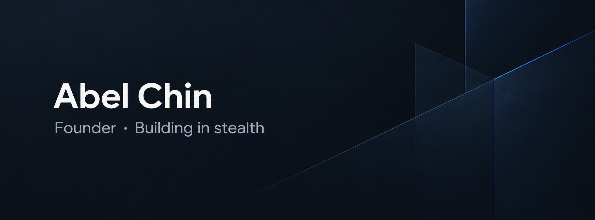

## hey! i'm abel 👋

<div align="center">
  
</div>

<h3 align="center">currently an indie ai engineer, ex nus cs, resuming my undergrad studies in sg this july 2026</h3>

<div align="center">
  
</div>

---

### 🚀 about me

- 🔭 i work on **technical open-source AI literacy programs for Malaysian youths at Nyala Labs**
- 🌱 i'm currently learning **OpenClaw**
- 🤝 i'm looking to collaborate on **my startup endeavor and Nyala Labs' future events**
- 💬 hit me up and let's have a coffee chat!
- 📫 how to reach me: **[abelchinjh@gmail.com](mailto:abelchinjh@gmail.com)**

---

### 🛠️ tech stack

| AI & Backend | Frontend & UI | Database & Ops |
| :--- | :--- | :--- |
|  |  |  |
|  |  |  |
|  |  |  |
|  |  |  |

---

### 📊 github stats

<div align="center">
  
  <br/>
  <br/>
  
</div>

---

### 🧑🏻‍💻 weekly coding stats
<!--START_SECTION:waka-->


**🐱 My GitHub Data** 

> 📦 83.4 kB Used in GitHub's Storage 
 > 
> 🏆 638 Contributions in the Year 2026
 > 
> 🚫 Not Opted to Hire
 > 
> 📜 23 Public Repositories 
 > 
> 🔑 8 Private Repositories 
 > 
**I'm an Early 🐤** 

```text
🌞 Morning                846 commits         █████░░░░░░░░░░░░░░░░░░░░   18.61 % 
🌆 Daytime                1781 commits        ██████████░░░░░░░░░░░░░░░   39.17 % 
🌃 Evening                1126 commits        ██████░░░░░░░░░░░░░░░░░░░   24.76 % 
🌙 Night                  794 commits         ████░░░░░░░░░░░░░░░░░░░░░   17.46 % 
```
📅 **I'm Most Productive on Friday** 

```text
Monday                   730 commits         ████░░░░░░░░░░░░░░░░░░░░░   16.05 % 
Tuesday                  845 commits         █████░░░░░░░░░░░░░░░░░░░░   18.58 % 
Wednesday                367 commits         ██░░░░░░░░░░░░░░░░░░░░░░░   08.07 % 
Thursday                 661 commits         ████░░░░░░░░░░░░░░░░░░░░░   14.54 % 
Friday                   1163 commits        ██████░░░░░░░░░░░░░░░░░░░   25.58 % 
Saturday                 232 commits         █░░░░░░░░░░░░░░░░░░░░░░░░   05.10 % 
Sunday                   549 commits         ███░░░░░░░░░░░░░░░░░░░░░░   12.07 % 
```


📊 **This Week I Spent My Time On** 

```text
🕑︎ Time Zone: Asia/Singapore

💬 Programming Languages: 
Python                   10 hrs 48 mins      ██████████░░░░░░░░░░░░░░░   40.38 % 
JavaScript               6 hrs 19 mins       ██████░░░░░░░░░░░░░░░░░░░   23.64 % 
Markdown                 4 hrs 35 mins       ████░░░░░░░░░░░░░░░░░░░░░   17.15 % 
TypeScript               1 hr 52 mins        ██░░░░░░░░░░░░░░░░░░░░░░░   07.00 % 
JSON                     1 hr 24 mins        █░░░░░░░░░░░░░░░░░░░░░░░░   05.28 % 

🔥 Editors: 
Hermes                   23 hrs 24 mins      ██████████████████████░░░   87.41 % 
Zed                      3 hrs 20 mins       ███░░░░░░░░░░░░░░░░░░░░░░   12.46 % 
OpenCode                 1 min               ░░░░░░░░░░░░░░░░░░░░░░░░░   00.12 % 
```

🤖 **AI Coding This Week** 

```text
⏱ AI Coding Time: 26 hrs 3 mins (96.98%)

✍️ 912 lines written by AI, 0 lines written by hand (100.0% AI-written)

🔤 1,171,003 Input Tokens, 19,765 Output Tokens

💵 $3.81 Estimated AI Cost This Week

🧠 22 AI Sessions, 43 AI Prompts

Step                     915 lines           █████████████████████████   100.00 % 
Opencode-Cli             0 lines             ░░░░░░░░░░░░░░░░░░░░░░░░░   00.00 % 

🔎 AI Coding Insights:
🤖 AI-Driven — 100.0% of written lines came from AI
📝 Concise Prompter — average 146 characters per prompt
🔁 Iterative Prompter — average 2 prompts per session
🚀 High AI Trust — 0.0% of changed lines were hand-edited
```

**I Mostly Code in TypeScript** 

```text
TypeScript               22 repos            ████████████░░░░░░░░░░░░░   50.00 % 
Python                   10 repos            ██████░░░░░░░░░░░░░░░░░░░   22.73 % 
JavaScript               4 repos             ██░░░░░░░░░░░░░░░░░░░░░░░   09.09 % 
C                        3 repos             ██░░░░░░░░░░░░░░░░░░░░░░░   06.82 % 
CSS                      1 repo              █░░░░░░░░░░░░░░░░░░░░░░░░   02.27 % 
```


**Timeline**


 Last Updated on 15/10/2026 03:26:33 UTC
<!--END_SECTION:waka-->

---

### 📫 connect with me

<div align="center">
  <a href="https://linkedin.com/in/abelchinjh"></a>
  <a href="https://www.abelchin.my"></a>
</div>